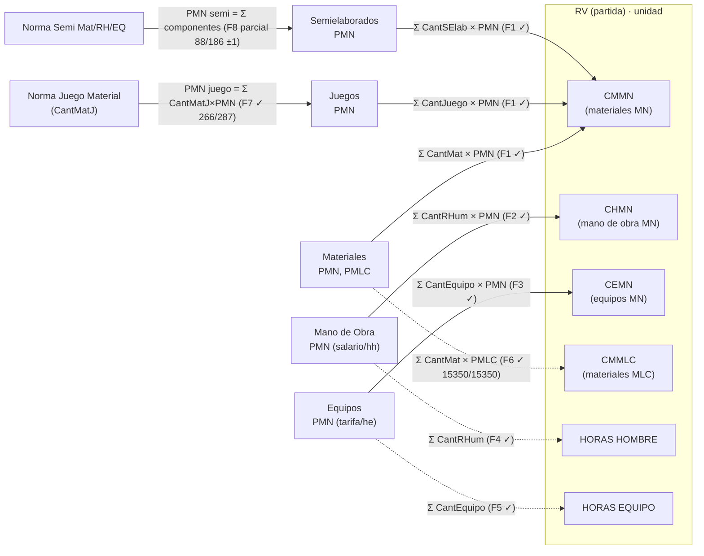
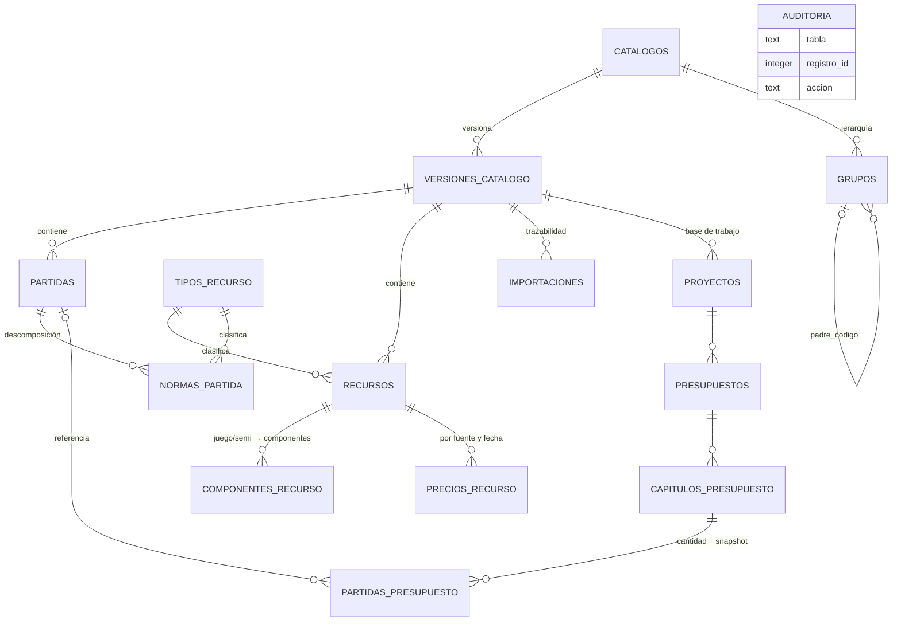

# FASE III — DIAGRAMAS RELACIONALES

Fecha: 2026-10-14 · Fuente de verdad: `docs/datos/fase3b_relaciones.json` (23/23 relaciones verificadas con datos, 0 huérfanos)

## 1. Modelo entidad-relación de PRECODI (codigo.mdb, núcleo canónico)

```mermaid
erDiagram
    SOBREGRUPOS_RV {
        text CodSobreG PK "2 dígitos, 40 filas"
        text SubreGrupo "Descripción"
    }
    GRUPOS_RV {
        text CodSobreG PK_FK "→ SobreGrupos"
        text CodG PK "3 dígitos, 320 filas"
        text Grupo "Descripción"
    }
    SUBGRUPOS_RV {
        text CodSobreG PK_FK
        text CodG PK_FK
        text CodSubG PK "4 dígitos, 1518 filas"
        text SubGrupo "Descripción"
    }
    RV {
        text CodSobreG PK_FK "→ SobreGrupos (verificado)"
        text CodG PK_FK "→ Grupos (verificado)"
        text CodSubG PK_FK "→ SubGrupos (verificado)"
        text CODIGO_RV PK "6 dígitos — ÚNICO por sí solo (15351/15351)"
        text Desc_Rv "Descripción normativa"
        text UNIDAD_DE_MEDIDA "u, m2, tm, ml, m3…"
        currency CMMN "Costo materiales MN"
        currency CHMN "Costo mano de obra MN"
        currency CEMN "Costo equipos MN"
        currency CMMLC "Costo materiales MLC"
        double HORAS_HOMBRE "= Σ CantRHum (F4 ✓)"
        double HORAS_EQUIPO "= Σ CantEquipo (F5 ✓)"
        double PESO "fórmula PENDIENTE"
    }
    MATERIALES {
        text CodMat PK "10 dígitos, 7769 filas"
        text Material "Descripción"
        text UmRec "Unidad"
        currency PMN "Precio MN"
        currency PMLC "Precio MLC"
        currency PrecioU "= PMN + PMLC (F11 ✓)"
        currency PesoU "Peso kg"
    }
    MANO_DE_OBRA {
        text CodRHum PK "10 dígitos, 248 filas"
        text RHum "Oficio / categoría"
        text UmRec "hh"
        currency PMN "Salario MN/hh"
        text Grupo "Grupo salarial II–XII"
    }
    EQUIPOS {
        text CodEquipo PK "10 dígitos, 415 filas"
        text Equipo "Descripción"
        text UmRec "he"
        currency PMN "Tarifa MN/he"
    }
    JUEGOS {
        text CodJuego PK "10 dígitos, 328 filas"
        text Juego "Descripción"
        currency PMN "Precio MN/jg"
    }
    SEMIELABORADOS {
        text CodSElab PK "10 dígitos, 353 filas"
        text SElab "Descripción"
        currency PMN "Precio MN"
    }
    NORMA_MATERIALES {
        text CodigoRV PK_FK "→ RV"
        text CodMat PK_FK "→ Materiales"
        float CantMat "Coeficiente de consumo"
    }
    NORMA_MANO_DE_OBRA {
        text CodigoRV PK_FK "→ RV"
        text CodRHum PK_FK "→ Mano de Obra"
        text CodNorma PK "S/C o norma compleja"
        float CantRHum "hh por unidad de RV"
    }
    NORMA_EQUIPOS {
        text CodigoRV PK_FK "→ RV"
        text CodEquipo PK_FK "→ Equipos"
        text CodNorma PK
        float CantEquipo "he por unidad de RV"
    }
    NORMA_JUEGOS {
        text CodigoRV PK_FK "→ RV"
        text CodJuego PK_FK "→ Juegos"
        float CantJuego "jg por unidad de RV"
    }
    NORMA_SEMIELABORADOS {
        text CodigoRV PK_FK "→ RV"
        text CodSElab PK_FK "→ Semielaborados"
        float CantSElab "Consumo por unidad de RV"
    }
    NORMA_JUEGO_MATERIAL {
        text CodJuego PK_FK "→ Juegos"
        text CodMat PK_FK "→ Materiales"
        float CantMatJ "Consumo por juego"
    }
    NORMA_SEMI_MATERIAL {
        text CodSemi PK_FK "→ Semielaborados"
        text CodMat PK_FK "→ Materiales"
        float CantMatSE
    }
    NORMA_SEMI_RHUMANOS {
        text CodSemi PK_FK "→ Semielaborados"
        text CodRHum PK_FK "→ Mano de Obra"
        text CodNorma PK
        float CantRHumSE
    }
    NORMA_SEMI_EQUIPOS {
        text CodSemi PK_FK "→ Semielaborados"
        text CodEquipo PK_FK "→ Equipos"
        text CodNorma PK
        float CantEquipoSE
    }

    SOBREGRUPOS_RV ||--o{ GRUPOS_RV : "agrupa"
    GRUPOS_RV ||--o{ SUBGRUPOS_RV : "agrupa"
    SUBGRUPOS_RV ||--o{ RV : "clasifica"
    RV ||--o{ NORMA_MATERIALES : "se descompone en"
    RV ||--o{ NORMA_MANO_DE_OBRA : "se descompone en"
    RV ||--o{ NORMA_EQUIPOS : "se descompone en"
    RV ||--o{ NORMA_JUEGOS : "se descompone en"
    RV ||--o{ NORMA_SEMIELABORADOS : "se descompone en"
    MATERIALES ||--o{ NORMA_MATERIALES : ""
    MANO_DE_OBRA ||--o{ NORMA_MANO_DE_OBRA : ""
    EQUIPOS ||--o{ NORMA_EQUIPOS : ""
    JUEGOS ||--o{ NORMA_JUEGOS : ""
    SEMIELABORADOS ||--o{ NORMA_SEMIELABORADOS : ""
    JUEGOS ||--o{ NORMA_JUEGO_MATERIAL : "se compone de"
    MATERIALES ||--o{ NORMA_JUEGO_MATERIAL : ""
    SEMIELABORADOS ||--o{ NORMA_SEMI_MATERIAL : "se compone de"
    MATERIALES ||--o{ NORMA_SEMI_MATERIAL : ""
    SEMIELABORADOS ||--o{ NORMA_SEMI_RHUMANOS : "se compone de"
    MANO_DE_OBRA ||--o{ NORMA_SEMI_RHUMANOS : ""
    SEMIELABORADOS ||--o{ NORMA_SEMI_EQUIPOS : "se compone de"
    EQUIPOS ||--o{ NORMA_SEMI_EQUIPOS : ""
```

Todas las flechas del diagrama corresponden a relaciones **verificadas con datos** (0 valores huérfanos en los 23 cruces). Los símbolos ✓ en los atributos remiten a fórmulas verificadas en `MODELO_PRECIOS_UNITARIOS.md`.

## 2. Grafo de cálculo del precio unitario (semántica verificada)



**Precio unitario total MN de un RV = CMMN + CHMN + CEMN** (verificación masiva en `MODELO_PRECIOS_UNITARIOS.md`).

## 3. Esquema propuesto para PRECOST (migración 0001/0002) — resumen visual



El DDL completo con restricciones, índices y justificaciones está en `bd/migraciones/0001_catalogo.sql` y `0002_proyectos.sql`, documentado en `ESQUEMA_BD_PRECOST.md`.

## 4. Correspondencia de campos PRECODI → esquema PRECOST

| PRECODI (Jet) | PRECOST SQLite | Transformación |
|---|---|---|
| `Nomenclador de RV.CODIGO RV` | `partidas.codigo` | Directo (texto 6 d) |
| `Nomenclador de RV.{CMMN, CHMN, CEMN, CMMLC}` | `partidas.{costo_mat_mn, costo_mo_mn, costo_eq_mn, costo_mat_mlc}` | Directo |
| `Nomenclador de RV.UNIDAD DE MEDIDA` | `partidas.unidad` + `factor_unidad` | '100 m2' → ('m2', 100.0) |
| `Norma de Materiales (CodigoRV, CodMat, CantMat)` | `normas_partida (partida_id, tipo=material, codigo_recurso, coeficiente)` | Unión de 5 tablas de norma en una tabla tipada |
| `Nomenclador de Materiales.{PMN, PMLC, PrecioU, PesoU}` | `recursos.{precio_mn, precio_mlc, precio_total, peso_unidad}` | Directo |
| 5 nomencladores de recursos | `recursos` + `tipos_recurso` | Unificación con tipo discriminator |
| `Norma Juego Material` / `Norma Semi *` | `componentes_recurso` | Unión en una tabla de componentes |
| `NormaUsos`, `IdEstab`, `Id*` autonuméricos | — | **No se importan**: contadores/ids locales de Access no estables entre bases |
| (inexistente) | `catalogos`, `versiones_catalogo`, `importaciones`, `precios_recurso`, `auditoria` | Añadidos por diseño (procedencia y versionado ausentes en PRECODI) |
