# MODELO RELACIONAL — BASE INTEGRADA PRECODI/PRECOST (MISIÓN III-B)

Fecha: 2026-10-14 · Base: `bd/precodi.db` (SQLite, migraciones 0001+0002+0003)
Regla rectora: **versionado por catálogo** — nada se sobrescribe; cada importación crea
una versión inmutable con procedencia (archivo + SHA-256 + fecha) y todas las FK usan
`ON DELETE RESTRICT`.

---

## 1. Diagrama Entidad-Relación del esquema implementado

```mermaid
erDiagram
    catalogos ||--o{ versiones_catalogo : "catalogo_id"
    versiones_catalogo ||--o{ importaciones : "version_id"
    catalogos ||--o{ grupos : "catalogo_id + (nivel,codigo)"
    grupos |o--o{ grupos : "padre_codigo"
    versiones_catalogo ||--o{ partidas : "version_id"
    versiones_catalogo ||--o{ recursos : "version_id"
    tipos_recurso ||--o{ recursos : "tipo_id"
    versiones_catalogo ||--o{ normas_partida : "version_id"
    partidas ||--o{ normas_partida : "partida_id"
    tipos_recurso ||--o{ normas_partida : "tipo_recurso_id"
    recursos ||--o{ componentes_recurso : "recurso_id (juego/semi)"
    tipos_recurso ||--o{ componentes_recurso : "tipo_componente_id"
    recursos ||--o{ precios_recurso : "recurso_id"
    versiones_catalogo ||--o{ proyectos : "catalogo_version_id"
    proyectos ||--o{ presupuestos : "proyecto_id"
    presupuestos ||--o{ capitulos_presupuesto : "presupuesto_id"
    capitulos_presupuesto ||--o{ partidas_presupuesto : "capitulo_id"
    versiones_catalogo ||--o{ sbd_colecciones : "version_id"
    sbd_colecciones ||--o{ sbd_colecciones_recursos : "id_colec_origen (lógica)"
    versiones_catalogo ||--o{ sbd_colec_rv : "version_id"
    versiones_catalogo ||--o{ sbd_normas_recurso : "version_id"
    versiones_catalogo ||--o{ sbd_normas_rh_extendida : "version_id"
    versiones_catalogo ||--o{ sbd_normas_descriptivas : "version_id"
    versiones_catalogo ||--o{ sbd_tarifas_transporte : "version_id"
    versiones_catalogo ||--o{ sbd_tarifas_especiales : "version_id"
    versiones_catalogo ||--o{ sbd_duracion_costo_rv : "version_id"
    versiones_catalogo ||--o{ sbd_actividades_estimacion : "version_id"
    versiones_catalogo ||--o{ sbd_macros_rv : "version_id"
    versiones_catalogo ||--o{ sbd_obras : "version_id"
    sbd_obras |o--o{ sbd_objetos_obra : "id_obra (lógica)"
    versiones_catalogo ||--o{ sbd_etapas : "version_id"
    versiones_catalogo ||--o{ sbd_presupuesto_rv : "version_id"
    sbd_objetos_obra |o--o{ sbd_presupuesto_rv : "id_origen = id_obj_obra (16 816/16 816)"
    sbd_etapas |o--o{ sbd_presupuesto_rv : "id_origen = id_etapa (16 816/16 816)"
    sbd_presupuesto_rv ||--o{ sbd_presupuesto_recursos : "id_prv_origen (lógica)"
```



## 2. Núcleo versionado (migración 0001, ampliada por 0003)

| Tabla | PK | Claves naturales UNIQUE | Rol |
|---|---|---|---|
| `catalogos` | id | codigo | PRECODI, PRECONS_III |
| `versiones_catalogo` | id | (catalogo_id, version) | versión inmutable + procedencia (fuente_archivo, fuente_sha256, fecha) |
| `importaciones` | id | — | registro por intento: filas_por_tabla (JSON), advertencias (JSON), resultado ok/ok_con_advertencias/error |
| `grupos` | id | (catalogo_id, nivel, codigo) y (catalogo_id, codigo) | jerarquía capítulo→grupo→subgrupo; FK compuesta al padre |
| `partidas` | id | (version_id, codigo) | + factor_unidad, costos MN/MLC, horas, peso, es_oficial, res/fcha aprobación y columnas de fidelidad 0003 (chmlc, cemlc, horas_operario/ayudante, tipo_rv, desc_corta) |
| `tipos_recurso` | id | codigo | material, mano_obra, equipo, juego, semielaborado |
| `recursos` | id | (version_id, tipo_id, codigo) | precios PMN/PMLC/PrecioU (Money exacto), peso, grupo salarial, especialidad, tipo equipo, norma horaria |
| `normas_partida` | id | (partida_id, tipo_recurso_id, codigo_recurso, cod_norma) | descomposición partida→recursos; coeficiente Float32 preservado; um_norma |
| `componentes_recurso` | id | (recurso_id, tipo_componente_id, codigo_componente, cod_norma) | descomposición de juegos (→materiales) y semielaborados (→mat/MO/equipo) |
| `precios_recurso` | id | (recurso_id, fuente, fecha) | evolución temporal de precios por fuente |
| `auditoria` | id | — | append-only |

## 3. Proyectos y presupuestos (migración 0002, sin cambios en esta misión)

`proyectos` → `presupuestos` (versiones de presupuesto, estado borrador/emitido/aprobado/cerrado)
→ `capitulos_presupuesto` → `partidas_presupuesto` (cantidad + snapshot inmutable de
costos en `costo_unitario_json`/`descomposicion_json` para que un cambio de catálogo no
altere presupuestos cerrados). Es el destino natural del editor de PRECOST en la siguiente
fase; hoy lo pueblan las composiciones SBD de referencia (§4).

## 4. Entidades SBD priorizadas (migración 0003)

Ver `docs/DICCIONARIO_PRECODI.md` §3.1 para la correspondencia fuente→destino y las
verificaciones con datos. Relaciones lógicas verificadas (sin FK física para no rigidizar
datos heredados imperfectos, contadas y documentadas):

- `sbd_presupuesto_rv.id_obj_obra → sbd_objetos_obra.id_origen` — 16 816/16 816
- `sbd_presupuesto_rv.id_etapa → sbd_etapas.id_origen` — 16 816/16 816
- `sbd_presupuesto_rv.codigo_rv → partidas.codigo` — 16 816/16 816
- `sbd_presupuesto_recursos.id_prv_origen → sbd_presupuesto_rv.id_prv_origen` — 18 816/18 816
- `sbd_colec_rv.codigo_rv → partidas.codigo` — verificado al importar (huérfanas contadas)

## 5. Correspondencia con el modelo de fuentes PRECODI

| Relación en las .mdb (fase III-B: 23/23 verificadas) | Implementación en SQLite |
|---|---|
| Norma de Materiales.CodigoRV → Nomenclador de RV.CODIGO RV | `normas_partida.partida_id → partidas.id` (FK física) |
| Norma *.CodMat/CodRHum/CodEquipo/CodJuego/CodSElab → Nomenclador * | `normas_partida.codigo_recurso` (+ `tipo_recurso_id`) referencia lógica a `recursos` (sin FK física: los huérfanos se preservan y cuentan) |
| Norma Juego Material.CodJuego → Nomenclador de Juegos | `componentes_recurso.recurso_id → recursos.id` (FK física) |
| Norma Semi *.CodSemi → Nomenclador de Semielaborados | `componentes_recurso.recurso_id → recursos.id` (FK física) |
| Nomenclador de RV.CodSobreG/CodG/CodSubG → Nomencladores de grupos | `partidas.capitulo` + jerarquía `grupos` (en SBD, capítulo derivado del prefijo del código por ausencia de columnas) |
| Presupuesto Composición RV.IdObjObra → Objetos de Obra.IdObjObra | `sbd_presupuesto_rv.id_obj_obra → sbd_objetos_obra.id_origen` (lógica, 16 816/16 816) |

## 6. Vista de consulta vertical (la que usa PRECOST)

```
partidas (versión V) ── normas_partida ─── recursos (versión V, mismo tipo)
        │                     │ coeficiente × recursos.precio_mn = subtotal
        │                     └── (juego/semi) componentes_recurso ─── recursos componentes
        └── versiones_catalogo → catalogos: procedencia (archivo, SHA-256, fecha)
Σ subtotales por tipo ↔ costos almacenados (CMMN/CHMN/CEMN) → verificación con tolerancia
```

Ejemplo probado (caso documentado 012141, raíz 2017): 3 materiales + 1 MO + 5 equipos =
9 componentes; Σ coef×precio material = 2.629000 vs CMMN almacenado 2.6290 (Δ 0.000000).
